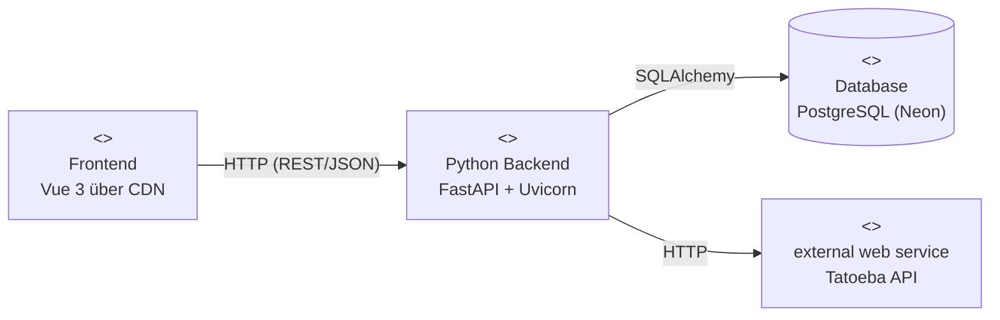
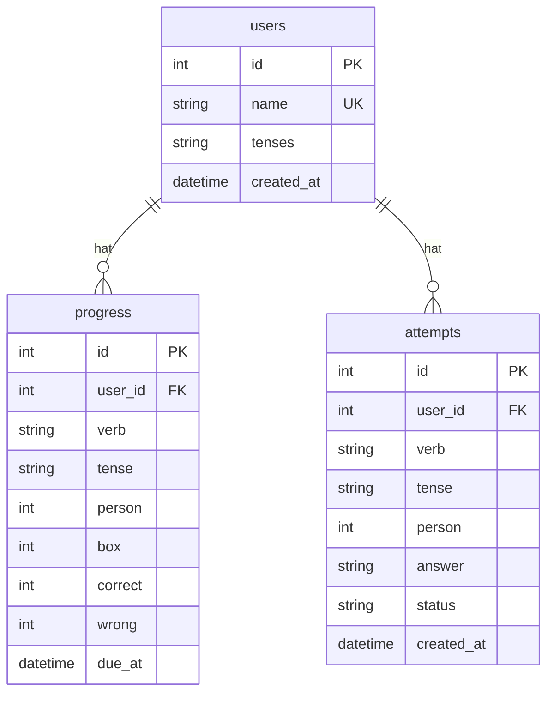
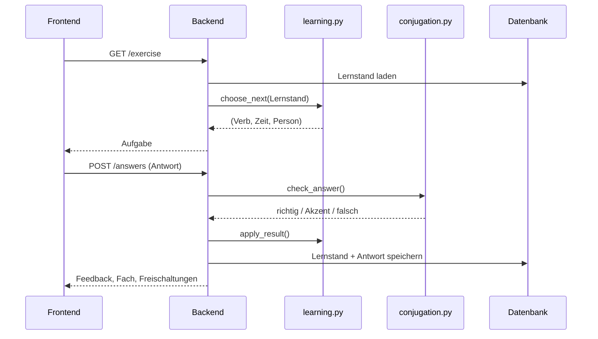

# Architektur

## Komponenten

Das entspricht der in der Aufgabenstellung vorgegebenen Struktur. Das Backend
liefert das Frontend als statische Dateien gleich mit aus (ein Webdienst).

## Schichten im Backend

| Schicht | Modul | Abhängigkeiten |
| --- | --- | --- |
| Web / REST | `main.py` | FastAPI, alle anderen Module |
| Fachlogik Konjugation | `conjugation.py` (inkl. Zeiten-Registry) | nur Python-Standardbibliothek |
| Fachlogik Lernen | `learning.py` | nur `conjugation.py` |
| Persistenz | `db.py` | SQLAlchemy |
| Externer Dienst | `examples.py` | httpx |

Die Fachlogik kennt weder FastAPI noch die Datenbank. `main.py` lädt den
Lernstand aus der Datenbank, übergibt ihn als einfache Datenobjekte
(`ItemState`) an die Lernlogik und speichert das Ergebnis wieder.

## Datenmodell

* `users.tenses`: gewählte Zeiten, kommagetrennt; leer = automatisch (Lernpfad).
* `progress`: genau eine Zeile pro Benutzer und Item (Verb, Zeit, Person),
  eindeutig über einen Unique-Constraint.
* `attempts`: jede Antwort, für Verlauf, Trefferquote und Übungstage.
* Die Verben selbst liegen nicht in der Datenbank, sondern in
  `src/app/data/verbs.json` (fachliche Stammdaten, versioniert mit dem Code).

## REST-Schnittstelle

| Methode | Pfad | Zweck |
| --- | --- | --- |
| GET | `/api/health` | Health-Check für Render und CI |
| GET | `/api/tenses` | alle registrierten Zeiten in der Reihenfolge des Lernpfads |
| GET | `/api/verbs` | alle Verben |
| GET | `/api/verbs/search?q=` | Verb suchen, Italienisch oder Deutsch; kann mehrere Treffer liefern |
| GET | `/api/verbs/{verb}` | Konjugationstabelle (Nachschlagen) |
| GET | `/api/verbs/{verb}/examples?tense=&person=` | Beispielsätze (Tatoeba) |
| POST | `/api/users` | anmelden bzw. anlegen (nur Name) |
| PUT | `/api/users/{name}/settings` | Zeiten wählen (`{"tenses": [...]}`, leer = automatisch) |
| GET | `/api/users/{name}/exercise` | nächste Aufgabe, optional `verb`, `tense` |
| POST | `/api/users/{name}/answers` | Antwort prüfen und Lernstand speichern (Üben) |
| GET | `/api/users/{name}/progress` | Fortschritt |

Die vollständige, automatisch erzeugte Dokumentation ist unter `/docs`
abrufbar (FastAPI/OpenAPI).

## Ablauf einer Übung

## Erweiterbarkeit

* **Neue Zeit:** eine Funktion in `conjugation.py` schreiben und mit
  `register(Tense(...))` anmelden. Alle anderen Teile lesen die Registry
  (`TENSES`, `tense_order()`, `/api/tenses`). Anleitung: `docs/extending.md`.
* **Neues Verb:** Eintrag in `src/app/data/verbs.json`.
* **Lernparameter:** Startmenge, Schrittgrösse, Schwelle und Wartezeiten sind
  Konstanten oben in `learning.py`.

## Entscheide

| Nr | Entscheid |
| --- | --- |
| 0001 | Backend-Framework FastAPI |
| 0002 | Frontend Vue 3 über CDN |
| 0003 | Benutzer mit Namen ohne Passwort |
| 0004 | Umfang der ersten Version |
| 0005 | SQLAlchemy mit SQLite lokal, PostgreSQL produktiv |
| 0006 | Hosting auf Render und Neon |
| 0007 | Tatoeba als externer Webdienst |
| 0008 | Konjugation regelbasiert mit Ausnahmeliste |
| 0009 | Karteikasten mit schrittweiser Freischaltung |
| 0010 | Zeiten als Registry (Erweiterbarkeit) |
| 0011 | Zeitenwahl: eigene Auswahl geht vor dem Lernpfad |
| 0012 | Schichten: Fachlogik ohne Framework und Datenbank |
| 0013 | Antwortprüfung mit gezielten Toleranzen |
| 0014 | Verbdaten als JSON statt in der Datenbank |

Details in `docs/decisions/`, Herausforderungen und ihre Lösungen in
`docs/challenges.md`.
