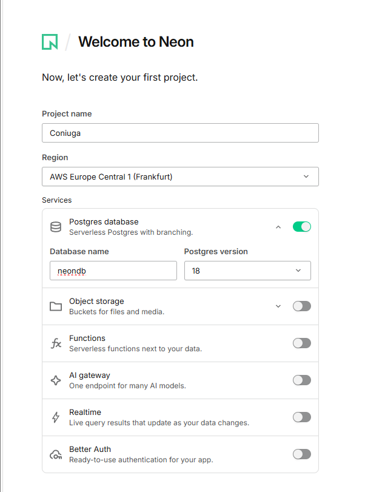

# Hosting: Render (App) und Neon (Datenbank)

Date: 2026-11-19 (ergänzt 2026-11-21 mit den Einstellungen beim Einrichten)

## Status

Accepted

## Context

Die App muss bis Ende der Prüfungssession öffentlich erreichbar und automatisch deploybar sein. Erfahrung aus einem anderen Projekt: Die Gratis-Datenbank von Render läuft nach 30 Tagen ab.

## Options Considered

 * Render für App und Datenbank: alles an einem Ort, aber die Datenbank läuft nach 30 Tagen ab.
 * Azure App Service: im Template dokumentiert, aber Konto und Konfiguration aufwändiger.
 * Render für die App (Docker) und Neon für PostgreSQL: beide gratis, Neon ohne Ablaufdatum.

## Decision

Render (Docker-Webdienst, render.yaml) und Neon (PostgreSQL). Entschieden von Kay.

Beim Einrichten gewählt, in der Reihenfolge der Schritte:

1. Neon-Projekt: Region Frankfurt, PostgreSQL 18, nur der Dienst «Postgres database» eingeschaltet.
2. Verbindung zur Datenbank: ohne Connection Pooling von Neon (direkte Verbindung).
3. Render: ebenfalls Region Frankfurt (`region: frankfurt` in render.yaml).

## Reasons

### Warum Render und Neon

Gratis, automatisches Deployment bei jedem Push auf master, Datenbank ohne Ablaufdatum. Das Docker-Image ist dasselbe, das in der CI gebaut und getestet wird.

### Schritt 1: Neon-Projekt anlegen

Beim Anlegen fragt Neon nach Region, Version und weiteren Diensten.

**Region Frankfurt.** Die Region ist das Rechenzentrum, in dem die Datenbank läuft. Bei jeder Antwort im Training liest und schreibt die App in der Datenbank. Je näher App und Datenbank beieinander liegen, desto kürzer sind diese Wege. Frankfurt liegt zudem nahe bei den Benutzerinnen und Benutzern in der Schweiz. Die App kommt darum in Schritt 3 in dieselbe Region.

**PostgreSQL 18.** PostgreSQL erscheint jedes Jahr in einer neuen Hauptversion (17, 18, ...). Dazwischen gibt es Nebenversionen (18.5, 18.6, ...) mit Sicherheits- und Fehlerkorrekturen. Die PostgreSQL-Community versorgt jede Hauptversion fünf Jahre lang mit solchen Korrekturen, ähnlich einem Wartungsvertrag mit fester Laufzeit. Version 18 (erschienen September 2025) wird bis November 2030 gewartet, Version 17 bis November 2029. Neon bietet die Versionen 14 bis 18 an; 18 ist seit Mai 2026 voll für den produktiven Einsatz freigegeben und seit Juni 2026 der Standard für neue Projekte.

Für Coniuga macht die Wahl zwischen 17 und 18 funktional keinen Unterschied. Die App schreibt kein SQL von Hand: SQLAlchemy erzeugt Standard-SQL für drei einfache Tabellen, und der Treiber psycopg 3 unterstützt alle aktuellen Versionen. Den Ausschlag gibt die längere Wartung.

Gegenargument: Für geschäftskritische Systeme wird oft empfohlen, eine Hauptversion hinter der neuesten zu bleiben, weil neue Hauptversionen anfangs noch Fehler haben können. Bei einer Lernapp mit einfachen Abfragen wiegt dieses Risiko weniger als die längere Wartung.

**Weitere Dienste ausgeschaltet.** Neon bietet neben der Datenbank weitere Dienste an. Sie wurden angeschaut und bewusst ausgeschaltet gelassen:

| Dienst | Was er macht | Warum Coniuga ihn nicht braucht |
| --- | --- | --- |
| Object storage | Ablage für Dateien (Bilder, Uploads) | Coniuga speichert keine Dateien. Die Verben liegen versioniert in `verbs.json` (Entscheid 0014). |
| Functions | Eigener Programmcode, der bei Neon läuft (Node.js) | Die Fachlogik läuft in Python im Container auf Render. Ein zweiter Ort für Code würde die Architektur aufteilen. |
| AI gateway | Eine Schnittstelle zu Sprachmodellen verschiedener Anbieter | Coniuga hat keine KI-Funktion. Für eine spätere Erweiterung siehe `extending.md`. |
| Realtime | Meldet Änderungen in der Datenbank sofort an den Browser | Jede Person übt allein; der Browser fragt nur nach, wenn eine Antwort abgeschickt wird. |
| Better Auth | Anmeldung mit Passwort oder Konten wie Google | Benutzer melden sich bewusst ohne Passwort an (Entscheid 0003). |

Jeder zusätzliche Dienst wäre eine weitere Abhängigkeit von Neon und ein weiterer Teil, der getestet und erklärt werden muss.

Die Agent-Anleitungen, die Neon danach anbietet («Set up Neon with your coding agent»), wurden ebenfalls nicht genutzt. Sie sind für JavaScript-Projekte gedacht und würden die Zugangsdaten in eine Datei im Projektordner schreiben. Coniuga braucht von Neon nur die Verbindungsadresse, und die steht ausschliesslich bei Render.

### Schritt 2: Verbindung zur Datenbank (Connection Pooling)

**Was eine Verbindung ist.** Bevor die App etwas in der Datenbank lesen oder speichern kann, öffnet sie eine Verbindung: anmelden, Passwort prüfen, Verschlüsselung aufbauen. Das kostet jedes Mal Zeit und auf dem Datenbankserver Speicher.

**Was Pooling ist.** Geöffnete Verbindungen werden nicht nach jeder Anfrage geschlossen, sondern in einem «Pool» bereitgehalten und wiederverwendet. Bild: Statt für jede Fahrt ein Taxi zu bestellen, steht eine kleine Flotte bereit.

**Pooling gibt es an zwei Orten.**

* In der App: SQLAlchemy führt einen eigenen Pool. `create_engine` in `src/app/db.py` legt ihn automatisch an. Mit `pool_pre_ping=True` prüft die App vor jeder Nutzung kurz, ob die Verbindung noch lebt; das ist wichtig, weil Neon die Datenbank im Gratisplan nach einer Pause schlafen legt.
* Bei Neon (Schalter «Connection pooling»): Ein Vermittler namens PgBouncer steht zwischen App und Datenbank und teilt wenige echte Verbindungen auf sehr viele Anfragen auf. Erkennbar ist er an `-pooler` in der Adresse.

**Entscheid: Pooling bei Neon ausgeschaltet.** Coniuga läuft als einzelner Container und öffnet höchstens ein paar Verbindungen. Neon erlaubt im Gratisplan 894 direkte Verbindungen (Anzeige unter «Computes»), also weit mehr als nötig. Der Pool in der App reicht dafür; ein zweiter Pool bei Neon bringt keinen Nutzen, ist aber ein zusätzlicher Teil, der verstanden und erklärt werden muss. Neons Vermittler lohnt sich, wenn sehr viele Programme gleichzeitig zugreifen.

**Geprüfte Bedenken.** Bei einem Vermittler wie PgBouncer gab es früher ein bekanntes Problem: Treiber wie psycopg bereiten häufig wiederholte Abfragen bei der Datenbank vor («prepared statements»), damit sie schneller laufen. Teilt der Vermittler die Verbindungen neu auf, findet die Datenbank eine solche vorbereitete Abfrage nicht mehr, und es erscheint ein Fehler wie «prepared statement does not exist». Laut den Dokumentationen von Neon und psycopg ist das heute gelöst: Neon unterstützt diese vorbereiteten Abfragen auch mit Pooling, und psycopg ab Version 3.2 ebenfalls (Coniuga verlangt mindestens 3.2). Dieses Risiko ist also kein Grund für den Entscheid mehr; ohne Pooling stellt sich die Frage aber gar nicht erst.

Sollte Coniuga später auf mehrere Container wachsen, kann der Schalter eingeschaltet und die neue Adresse bei Render hinterlegt werden. Am Code ändert sich dafür nichts.

### Schritt 3: Render in derselben Region

Ohne Angabe startet Render einen Dienst in Oregon (USA), und jede Abfrage an die Datenbank in Frankfurt müsste über den Atlantik. Die Region lässt sich bei Render nach dem Anlegen nicht mehr ändern. Darum steht `region: frankfurt` in render.yaml, bevor der Dienst zum ersten Mal angelegt wird.

## Consequences

Der Gratisplan von Render legt die App nach Inaktivität schlafen; der erste Aufruf dauert dann rund eine Minute.

Auch die Datenbank schläft: Der «Compute» bei Neon ist der Rechner, auf dem die Datenbank läuft (die Daten selbst liegen getrennt davon im Speicher von Neon und gehen dabei nicht verloren). Im Gratisplan passt Neon seine Grösse automatisch zwischen 0.25 und 2 Compute Units an (etwa 1 bis 8 GB Arbeitsspeicher) und schaltet ihn nach 5 Minuten ohne Anfrage ab («Scale to zero», im Dashboard als «Suspended» angezeigt). Die erste Anfrage danach weckt ihn wieder und dauert etwas länger. Diese Einstellungen bleiben auf dem Standard; ändern liesse sich «Scale to zero» nur in einem bezahlten Plan. Weil die Datenbank zwischendurch abgeschaltet wird, prüft die App mit `pool_pre_ping=True` vor jeder Nutzung, ob eine Verbindung noch lebt (siehe Schritt 2).

Die Verbindungsadresse von Neon enthält das Passwort. Sie wird nur bei Render als `DATABASE_URL` hinterlegt, nie im Repo, in einer Mail oder in einem Chat.

Neon spielt Nebenversionen (zum Beispiel 18.5 auf 18.6) beim nächsten Neustart der Datenbank automatisch ein. Eine neue Hauptversion übernimmt Neon nicht selbst und lässt sich auch nicht zurückstufen: Dafür bräuchte es ein neues Projekt und eine Übertragung der Daten. Vor November 2030 ist das nicht nötig.
